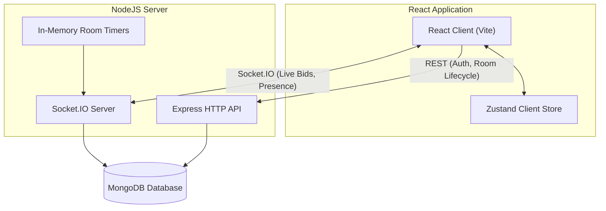

# System Architecture

This document describes the high-level architecture, data models, real-time event mapping, and concurrency mechanisms used in the Gavel platform.

---

## Architecture Overview

The platform uses a decoupled client-server architecture with state kept authoritative on the server and persisted in MongoDB.



### Components

1. **React Frontend**: Built with React 19, Vite, Tailwind CSS, and Zustand. State is synced dynamically via Socket.IO, but auth/login and initialization happen via REST API calls. Zustand is used purely for lightweight client-side convenience (e.g., maintaining the session room token).
2. **Express API**: Handles user authentication (JWT-based), creating/joining rooms, retrieving room summaries, and catalog initialization.
3. **Socket.IO Server**: Manages full-duplex realtime connections, participant presence (joined/left indicators), live bid submissions, and live active item status updates.
4. **Room Timers**: Each instance keeps an in-memory `setTimeout` per live room as the fast path, and also runs a one-second sweep over MongoDB for active items whose deadline has passed. The sweep is the backstop: an item resolves even if the instance holding its timer died.
5. **MongoDB**: The single source of truth for all database collections (Rooms, Participants, AuctionItems, Bids).
6. **Optional Redis (off by default)**: With `REDIS_URL` set, broadcasts, presence and rate-limit counters are shared across instances. Without it the server behaves exactly as a single process, and MongoDB stays the only source of truth either way.

---

## Real-Time Socket.IO Lifecycle

Socket connections are room-scoped. The client sends a per-room `sessionToken` during the handshake, and the server joins the socket to a room channel (`room:{code}`).

### Event Map

| Event Name | Direction | Payload | Description |
|---|---|---|---|
| `room:connect` | Client → Server | *None* | Sent after every connect. Identity comes from the handshake, so no payload is needed. Triggers a full state synchronization. |
| `room:state` | Server → Client | `{ room, participants, activeItem, bids, items, serverTime }` | Sent only to the requesting socket. `activeItem` and `bids` are populated when the room is live; `serverTime` lets the client measure its clock offset. |
| `participant:joined` | Server → Client | `{ participant }` | Broadcast to the rest of the room when a bidder comes online. Not re-sent for a second tab. |
| `participant:left` | Server → Client | `{ participant }` | Broadcast when a bidder's last socket has been gone for the full presence grace period (`PRESENCE_GRACE_MS`, default 10s). A reconnect inside that window cancels it, so a transient network drop produces no roster flicker. |
| `item:added` | Server → Client | `{ item }` | Emitted from the REST item handler so lobby catalogs update without a refetch. |
| `auction:start` | Client → Server | *None* | Host only. Moves the room from `lobby` to `live`. |
| `auction:started` | Server → Client | `{ room }` | Tells every client to move from the lobby to the auction board. |
| `item:activated` | Server → Client | `{ item, startedAt, endsAt, version }` | The new active item plus the server's clock at activation and the absolute deadline. `version` starts the item's event sequence (see Concurrency §14). |
| `auction:pause` | Client → Server | *None* | Host only. Freezes the countdown on the active item. |
| `auction:paused` | Server → Client | `{ itemId, remainingMs, version }` | Broadcast when the clock stops. `remainingMs` is what the client renders in place of a live countdown. |
| `auction:resume` | Client → Server | *None* | Host only. Restarts the countdown from where it stopped. |
| `auction:resumed` | Server → Client | `{ item, endsAt, serverTime, version }` | Broadcast with the new absolute deadline and the server clock for offset correction. |
| `bid:place` | Client → Server | `{ amount: number, itemId?: string, bidId?: string }` | Bidders only. Hosts are rejected. The payload is read defensively: a non-object payload yields `undefined` rather than throwing. `itemId` names the item the bidder was looking at; a mismatch is rejected as `STALE_ITEM`. `bidId` is a client-generated id (8–64 letters, digits or dashes) that makes a retry idempotent. Both are optional, so older clients keep working. |
| `bid:accepted` | Server → Client | `{ bid, item, version, duplicate? }` | Broadcast to the room. `item` carries the new highest bid and the extended `endsAt`. A retried `bidId` is answered to the sender only, with `duplicate: true` and no `version`. |
| `bid:rejected` | Server → Client | `{ reason: string, minimumBid?: number, retryAfterMs?: number }` | Sent only to the submitting socket. `minimumBid` is present only when the server actually read the active item; it is omitted rather than invented on paths that rejected earlier. `retryAfterMs` appears only on throttled bids. A `code` field (for example `BID_TOO_LOW`, `STALE_ITEM`, `RATE_LIMITED`) identifies the reason by machine. |
| `item:sell` | Client → Server | *None* | Host only. Requires at least one accepted bid. |
| `item:unsold` | Client → Server | *None* | Host only. Clears any recorded highest bidder. |
| `item:ended` | Server → Client | `{ item, resolution: "sold" \| "unsold", winner, version }` | The item was resolved, by the host or by expiry. `winner` is the debited participant on a sale, `null` otherwise. |
| `auction:completed` | Server → Client | `{ room }` | No pending items remain; clients redirect to results. |
| `error` | Server → Client | `{ message: string }` | Sent only to the offending socket for authorization and lifecycle failures. |

---

## Concurrency and Race Conditions

Handling highly concurrent live bids and timer-expiration states is a core requirement of a robust auction engine. The system achieves complete correctness using server-authoritative logic and atomic database updates.

### 1. Atomic Bids (`findOneAndUpdate`)
When multiple bidders submit identical or incremental bids simultaneously, a read-then-write pattern can accept two winners or a bid below the current minimum. The server instead resolves each bid with one conditional update:

```typescript
const newEndsAt = new Date(Date.now() + env.auctionItemDurationSeconds * 1000);

const updatedItem = await AuctionItem.findOneAndUpdate(
  {
    _id: activeItem._id,
    status: "active",
    isPaused: false,
    endsAt: { $gt: new Date() },
    // The price floor is computed from the document's own fields rather than
    // from values read a moment earlier.
    $expr: {
      $cond: {
        if: { $gt: ["$currentBid", 0] },
        then: { $gte: [amount, { $add: ["$currentBid", room.minBidIncrement] }] },
        else: { $gte: [amount, "$startingBid"] },
      },
    },
  },
  {
    $set: {
      currentBid: amount,
      highestBidderId: participant._id,
      highestBidderUsername: participant.username,
      endsAt: newEndsAt,
    },
  },
  { new: true },
);
```

Only one execution can satisfy the floor; any concurrent bid at the same or a lower amount fails the filter and returns `null`. The loser receives `bid:rejected` with the new minimum.

**Why `$expr` rather than a plain comparison.** A filter like `currentBid: { $lt: amount }` compares correctly but encodes the wrong rule — it permits a one-rupee raise, which makes the countdown extension farcical: two bidders could hold an item open indefinitely without the price meaningfully moving. Rooms therefore carry a `minBidIncrement`, and the floor is `currentBid + minBidIncrement`.

That floor has to be evaluated against the *live* document. Computing it in application code from a value read moments earlier would let a bid that was legal when validated slip through after the price had already moved — two bidders both seeing ₹1,000 would both calculate ₹1,100 as legal, and the loser's amount would no longer be a full increment above the new price. `$expr` moves the arithmetic inside the query so it is always measured against the current row.

The opening bid is deliberately exempt: with no bids yet the floor is the asking price exactly, because an increment on top of it would mean the advertised price was never actually available.

The same update extends the deadline. An accepted bid restores the full countdown, so a bid landing in the final second cannot win uncontested — see [DECISIONS.md](DECISIONS.md) for that trade-off.

**Write ordering.** The `bids` collection is an append-only log, and an entry is written *only after* the claim succeeds. Writing it first and deleting it on failure would make a rejected bid briefly readable by a concurrent `room:connect`, and would orphan it permanently if the process died between the write and the compensating delete.

### 2. Item Resolution Races
An active item can be resolved three ways: the countdown expires, the host sells, or the host marks it unsold. The transition is claimed conditionally so only one can win:

```typescript
const claim: Record<string, unknown> = { _id: activeItem._id, status: "active" };

// An expiry must also prove the deadline has actually elapsed.
if (requestedResolution === "expired") {
  claim.endsAt = { $lte: new Date() };
}

const resolvedItem = await AuctionItem.findOneAndUpdate(
  claim,
  { $set: update },
  { new: true },
);
```

If the timer fires at the same millisecond the host clicks Sell, exactly one update moves the status off `"active"`; the other fails the filter and no-ops, so the catalog cannot advance twice.

The extra `endsAt` condition on the expiry path closes a subtler race. A bid accepted moments before expiry pushes `endsAt` into the future and reschedules the timer — but `clearTimeout` cannot recall a callback that has already fired and is awaiting its database reads. Without the elapsed-deadline check, that stale callback still matches on status alone and ends an item the bid had just extended, cutting short the very countdown the extension exists to protect. Host-initiated resolutions stay unconditional, because ending an item early is exactly what the host is asking for.

If an expiry loses the claim because the deadline moved, the callback re-arms a timer from the persisted deadline, so an active item is never left without one.

### 3. Server Resiliency & Timer Restoration
Timers are in-memory, but deadlines are persisted as absolute timestamps. On boot the server rebuilds a timer for every live room:

```typescript
const liveRooms = await Room.find({
  status: "live",
  currentItemId: { $ne: null },
});

for (const room of liveRooms) {
  const endsAt = room.endsAt ?? getAuctionEndsAt(Date.now(), env.auctionItemDurationSeconds);
  scheduleAuctionTimer(io, room._id.toString(), endsAt);
}
```

A deadline already in the past yields a zero delay, so the item resolves immediately on startup rather than hanging.

Restoration only runs at boot, so on its own it cannot rescue an item whose timer lived on an instance that has since died. Every instance therefore also runs `startExpirySweep()`: once a second it queries `{ status: "active", isPaused: false, endsAt: { $lte: now } }` (served by the `{ status, endsAt }` index) and hands each match to the same `expireActiveItem()` the timer uses. Because the expiry is a conditional claim, a sweep, a timer and another instance's sweep can all fire for the same item and exactly one resolves it. The cost is one indexed query per instance per second; the worst case is an item resolving up to a second late when its timer was lost. The sweep skips ticks while MongoDB is disconnected and is stopped first during graceful shutdown.

### 4. Pausing Without Losing the Deadline

The countdown is an absolute timestamp, not a ticking counter, so pausing cannot simply "stop the clock" — there is no clock to stop. Instead the pause converts the deadline back into a duration:

```typescript
// `new: false` returns the document as it was at the instant of the swap, which
// is the only trustworthy reading of endsAt: a separate read could observe a
// value a concurrent bid had already extended.
const beforePause = await AuctionItem.findOneAndUpdate(
  { _id: itemId, status: "active", isPaused: false, endsAt: { $gt: new Date() } },
  { $set: { isPaused: true, endsAt: null } },
  { new: false },
);

const remainingMs = beforePause.endsAt.getTime() - Date.now();
```

The remainder is stored on the room, the in-memory timer is cleared, and resuming sets `endsAt` to `now + remainingMs` and re-arms it.

Three properties fall out of this:

- **Pausing closes bidding at the database.** `isPaused: false` is part of the bid claim, not merely a check before it, so a pause landing between the read and the update cannot let one last bid slip through after the clock has visibly stopped for everyone.
- **A paused item cannot expire.** `endsAt` is `null` while frozen, and `null` never satisfies `$lte` against a date, so the expiry claim finds nothing however long the pause lasts.
- **A double click is harmless.** The pause is itself a conditional claim on `isPaused: false`, so only one of two simultaneous requests can win and the remaining time is computed exactly once.

Restart recovery skips paused rooms entirely: with no deadline there is nothing to count down, and the host's resume is what re-arms the timer.

### 5. Budgets: Validate at Bid Time, Charge at Sale Time

Every bidder holds a purse (`budget`) and a running total (`spent`). A bid is rejected if it exceeds `budget - spent`; the winner is debited with a single `$inc` when the item resolves as sold.

**Why not reserve funds when the bid is placed?** Because every outbid participant would then need a refund, and a refund that fails leaves a purse permanently wrong. Charging at resolution means exactly one writer per item and no compensating transaction.

**Why is the budget check outside the atomic claim?** The claim operates on the item; the purse lives on the participant, and a single `findOneAndUpdate` cannot condition on both. That is safe here only because **exactly one item is live at a time**, so a bidder can hold at most one outstanding commitment. `spent` cannot move between the check and the claim except by an item resolving — which would fail the claim anyway on `status: "active"`.

That assumption is load-bearing. Auctioning several items simultaneously would break it: two bids could each pass the check and together exceed the purse. The fix then is a conditional decrement on the participant, `{ _id, $expr: { $gte: [{ $subtract: ["$budget", "$spent"] }, amount] } }`, reserving at bid time and refunding on outbid — which is precisely the complexity the sequential design avoids.

### 6. Presence, Reconnects and Restarts
Presence is tracked two ways: an in-memory tracker (`socket/presence.ts`) mapping participant id to live socket ids, which allows multiple tabs without duplicate join broadcasts, and an `isConnected` flag persisted on the participant so `room:state` can render the roster.

Losing the last socket does not immediately mark a participant offline. It arms an unref'd `setTimeout` of `PRESENCE_GRACE_MS` (default 10s). If the participant reconnects inside that window the timer is cancelled, the database is never written, and no `participant:left` or `participant:joined` is broadcast — the room never sees the blip. If they do not return, the timer fires, re-checks the socket count, and only then persists `isConnected: false` and broadcasts the departure.

The grace period exists because the common failure is not a clean close. A wifi hiccup drops the socket, the client reconnects a second later, and the previous design broadcast a leave immediately followed by a join. Every bidder in the room saw the roster flicker on every transient drop.

A restart loses the tracker but not the flag, which would leave every previous bidder shown as permanently online. Startup therefore clears all `isConnected` flags before restoring timers; live clients re-register on their next `room:connect`.

The tracker sits behind a `PresenceStore` interface (`realtime/presenceStore.ts`). The default is the in-memory tracker above. With Redis enabled, each participant is a hash of socket id → expiry timestamp, attach/detach/count run as Lua scripts so "was this the first socket?" is decided atomically, and each instance refreshes its own sockets every 10 seconds. A crashed instance's entries simply stop counting after 30 seconds, rather than keeping someone online forever. If Redis is unreachable, the store answers from this instance's local view.

**Known gap, multi-instance only:** the startup reset above clears `isConnected` for *every* participant, including people connected to other, healthy instances. They are shown offline until their next reconnect. It is left in place because removing it would reintroduce the permanently-online problem on a single instance, which is the deployment that actually runs.

### 7. The Socket Handshake Is an Untrusted Boundary
`socket.handshake.auth` is client-controlled JSON, and the two fields read from it — `sessionToken` and `roomCode` — reach a Mongoose query and a string method respectively. Neither is typed by the transport.

Mongoose does not cast or reject a query operator object supplied where a `String` path is expected. A handshake sending `sessionToken: { "$ne": null }` therefore reached the driver as a comparison expression rather than a literal, and `Participant.findOne` returned an arbitrary real participant — an authentication bypass requiring no credentials at all. `{ "$gt": "" }`, `{ "$regex": ".*" }` and `{ "$exists": true }` behaved identically.

Both fields now pass through `socket/validation.ts`, which reuses the same `requireString` guard the HTTP boundary already uses. A non-string is rejected before it can reach a query, which closes the injection and also removes the `roomCode.toUpperCase()` TypeError that previously surfaced to clients as "Internal server error".

Errors crossing back out are translated by `toSocketMessage`: an `AppError` keeps its message (the client's request was malformed), and anything else collapses to a generic string (the server broke). The HTTP `statusCode` on `AppError` is dropped, since sockets have no status codes.

### 8. Identity Is Per-Room, Not Global
The JWT carries `{ username, role }`, and `role` is hardcoded to `"participant"` at both login and register. That is deliberate, not an oversight: the JWT proves *who you are across the platform*, while the authority to run an auction belongs to a specific room. Host authority lives on the `Participant` document (`role: "admin"`), created when you call `POST /api/rooms`. Every host-only action re-reads that document server-side. A client editing its own token or local storage to claim `admin` changes nothing, because nothing reads role from the client.

The consequence to know: the `role` field inside the JWT is effectively decorative and should not be trusted for authorization. It is retained because the frontend uses it for cosmetic hints only.

### 9. Logout Does Not Terminate a Live Socket
`POST /api/auth/logout` clears the cookie. It does not revoke the JWT — the token stays valid until its 24h expiry — and it does not touch the participant `sessionToken`, so a socket that is already connected keeps working. That is the ordinary trade for stateless JWT: no server-side session store, at the cost of no instant revocation.

Where instant revocation is actually needed — a leaked token, a compromised deployment — the tool is `npm run rotate-sessions`, which regenerates every participant `sessionToken` so reconnects fail, followed by a restart to drop live sockets.

### 10. Two Writes Per Accepted Bid
An accepted bid performs the atomic claim on the item, then saves a `Bid` document as a separate write. There is no transaction. If the second write fails, the item still carries the correct `currentBid` and `highestBidderId` — the auction stays correct, because the item is the source of truth for price — but the append-only log is missing an entry.

This is a deliberate trade. A multi-document transaction on the hot path costs more than the invariant is worth, and the failure mode degrades an audit log rather than the auction itself.

The item `version` increment (§14) rides inside the claim itself, so it adds no write.

### 14. Event Sequence: a Version per Item
Broadcasts are not guaranteed to arrive in commit order: two bids accepted a millisecond apart can be emitted in either order, and a client that reconnects has simply missed whatever was sent in between. Every update that changes an item's visible state — activation, an accepted bid, pause, resume, resolution, and the restore path — therefore also does `$inc: { version: 1 }` in the same `findOneAndUpdate`, and the resulting number travels on `item:activated`, `bid:accepted`, `auction:paused`, `auction:resumed` and `item:ended`.

The client (`hooks/useSocket.ts`) holds the last version it applied for the current item:

| Incoming event | Client action |
|---|---|
| version ≤ held | Ignore. It is a late or duplicate copy of something already applied. |
| version = held + 1 | Apply and advance. |
| version > held + 1 | A gap. Ignore it and re-emit `room:connect`, so `room:state` replaces local state with the truth. |
| a different item id | Same as a gap: resync. |
| no version (older server) | Apply as before. |

The field is additive. Clients that ignore it behave exactly as they did before.

### 15. Stale and Retried Bids
Two bid failures used to look like each other and like a low bid. Both are now explicit:

- **Stale item.** `bid:place` may carry `itemId`. If it is not the room's current item, the bid is rejected as `STALE_ITEM` before any claim. Without this, a bid queued during a reconnect could land on whichever item happened to be live by the time it arrived.
- **Retried bid.** `bid:place` may carry a client-generated `bidId`. The accepted `Bid` log entry stores it, under a unique partial index on `{ participantId, clientBidId }`. A repeat `bidId` with the same amount is answered with the original acceptance (`duplicate: true`, sender only) instead of a second claim or a misleading "too low". A repeat with a different amount is rejected as `INVALID_INPUT`.

The order is unchanged: the claim still runs before the log write. A second claim with the same `bidId` cannot win at the same amount anyway, because the price floor has moved. The unique index stops the log recording a reused id twice. **Admitted gap:** a client that deliberately reuses one `bidId` for two different, concurrent, both-winning amounts gets both claims and only one log entry, because the second write hits the index. The price is still right; that bid is missing from history and a warning is logged. Only a hand-crafted client can cause it, and the only effect is raising its own price.

### 16. Optional Redis Fan-out
Redis is opt-in and **not enabled in production** (see SCALING.md for why). With `REDIS_URL` unset, nothing below runs and no Redis package is ever connected.

With `REDIS_URL` set, `index.ts` connects before building the Socket.IO server and wires three things, each behind an interface whose default is the in-memory implementation:

| Concern | Interface | Redis implementation | When Redis is unreachable |
|---|---|---|---|
| Broadcasts | Socket.IO adapter | `@socket.io/redis-streams-adapter`, `onlyPlaintext: true` | Same-server clients still receive every event; other servers miss events until Redis returns |
| Rate limits | `RateLimitCheck` | Fixed window in a Lua script (`INCR` + `PEXPIRE` + `PTTL`) | Falls back to this instance's counters |
| Presence | `PresenceStore` | Hash of socket id → expiry, Lua scripts, 10 s heartbeat | Falls back to this instance's view |

Three details here are not obvious and were each found by testing:

- **`onlyPlaintext: true` is required.** The adapter otherwise msgpack-encodes any payload containing binary, and a Mongoose ObjectId holds a Buffer. Payloads then arrived on the other instance with fields such as `bid.amount` missing. Gavel never sends binary, so the JSON path (which honours `toJSON`) is the correct one.
- **Publishing fails fast; reading waits.** The cluster adapter delivers to local sockets only after the Redis publish resolves. node-redis queues commands while it reconnects, so during an outage local delivery would stall until Redis returned. Disabling the queue outright is worse: the adapter's read loop retries a failed `XREAD` with no backoff, and an instantly failing read spins the event loop. `failFastPublisher()` therefore rejects only `xAdd` while the client is not ready, and leaves the polling connections on the default queue.
- **Startup does not depend on Redis.** If it is unreachable within 5 seconds, the server logs the fact and runs in single-instance mode.

Sticky sessions are still required across instances for the HTTP long-polling transport.

### 11. Health Reports 200 While Degraded
`GET /health` returns HTTP 200 even when MongoDB is disconnected, with `status: "degraded"` and `ready: false` in the body. A transient database blip should not cause the platform to kill an otherwise healthy process, so readiness is expressed in the payload rather than the status code. Callers that care must read `ready`, not the status line.

Note the path: the health router is mounted at `/health`, outside the `/api` prefix. `/api/health` is a 404.

### 12. Timers on Shutdown
Auction countdowns are in-process `setTimeout` handles. Shutdown clears them explicitly before closing Socket.IO, so nothing fires against a closing server, but that is tidiness rather than correctness — they would die with the process regardless. Correctness comes from `restoreAuctionTimers()`, which rebuilds every live room's timer from the `endsAt` stored on the room. A deadline survives a restart because the database, not the process, holds it.

### 13. Database Availability
MongoDB is treated as a runtime dependency, not a startup precondition. The HTTP port binds first and the connection retries with exponential backoff, so an unreachable database degrades the API instead of failing the deploy. While disconnected, both entry points refuse work at the door — REST returns `503` and the socket handshake rejects with the same explanation — rather than letting queries sit in Mongoose's buffer until it times out.

---

## Database Schema

```
┌─────────────────────────────────────────────────────────────┐
│                            users                            │
│  Global accounts. Not linked to rooms: identity is global,  │
│  room role is not.                                          │
├─────────────────────┬──────────────────┬────────────────────┤
│ username (String)   │ passwordHash     │ salt (String)      │
│ usernameNormalized  │                  │                    │
│   (String, UQ)      │                  │                    │
└─────────────────────┴──────────────────┴────────────────────┘

┌─────────────────────────────────────────────────────────────┐
│                           rooms                             │
├─────────────────────┬──────────────────┬────────────────────┤
│ code (String, UQ)   │ status (Enum)    │ adminParticipantId │
│ name (String)       │ currentItemId    │ endsAt (Date)      │
└─────────────────────┴──────────────────┴────────────────────┘
                                   │
                                   ▼
┌─────────────────────────────────────────────────────────────┐
│                        auctionitems                         │
├─────────────────────┬──────────────────┬────────────────────┤
│ roomId (FK)         │ startingBid (No) │ status (Enum)      │
│ title (String)      │ currentBid (No)  │ endsAt (Date)      │
│ description (Str)   │ highestBidderId  │                    │
└─────────────────────┴──────────────────┴────────────────────┘
                                   ▲
                                   │
┌─────────────────────────────────────────────────────────────┐
│                            bids                             │
├─────────────────────┬──────────────────┬────────────────────┤
│ roomId (FK)         │ participantId    │ amount (Number)    │
│ itemId (FK)         │ username (String)│ createdAt (Date)   │
└─────────────────────┴──────────────────┴────────────────────┘
                                   ▲
                                   │
┌─────────────────────────────────────────────────────────────┐
│                        participants                         │
├─────────────────────┬──────────────────┬────────────────────┤
│ roomId (FK)         │ role (Enum)      │ isConnected (Bool) │
│ username (String)   │ sessionToken (UQ)│                    │
└─────────────────────┴──────────────────┴────────────────────┘
```

- **Unique constraints**: `participants` carries a compound unique index on `{ roomId, usernameNormalized }`, enforcing unique names within a room while allowing the same name across rooms. The application also pre-checks for a taken name, but that check is a read-then-write race; the index is the real guard and its duplicate-key error is translated back into the same message.
- **Supporting indexes**: `{ itemId, createdAt }` on `bids` for the newest-first log, `{ roomId, status, createdAt }` on `auctionitems` for the catalog listing and the conditional claim of the next pending item, and `{ status, endsAt }` on `auctionitems` for the expiry sweep.
- **Idempotency index**: `{ participantId, clientBidId }` on `bids`, unique, partial on `clientBidId` being a string, so bids without a `bidId` are unaffected.
- **Item version**: `auctionitems.version` (number, default 0) is the per-item event sequence. Documents created before it existed start counting from 1 on their next change.
- **Session security**: The host/bidder role is assigned server-side at room creation or join and bound to a random `sessionToken`, which must match a participant record during the socket handshake. The token is stripped from every participant list sent to clients.
- **Two identity layers**: the JWT cookie identifies the account across the app; the `sessionToken` identifies membership and role inside one room. They are deliberately separate so one account can host one room and bid in another.
