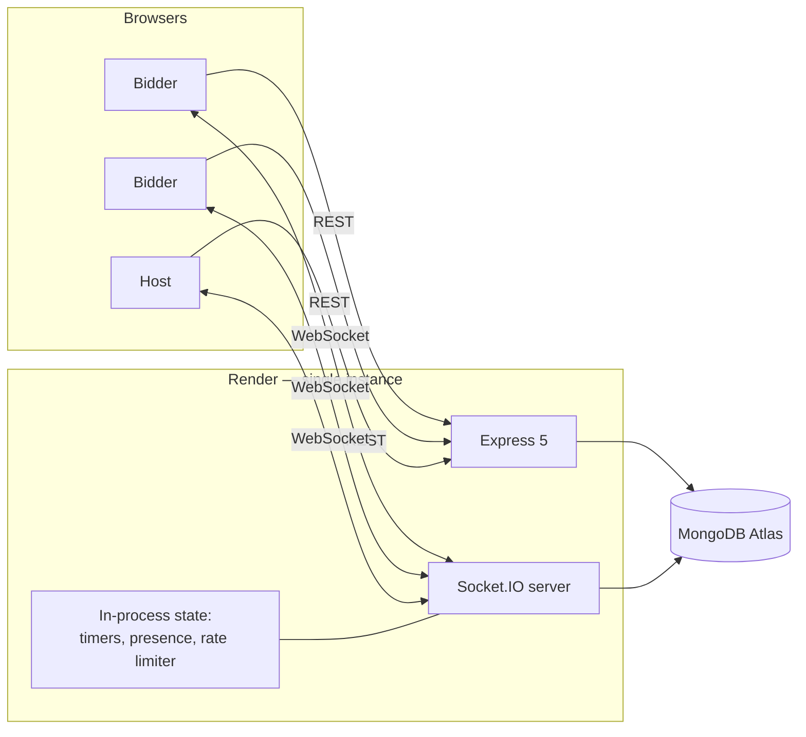

# Scaling

What this system can carry as built, what breaks first when it cannot, and what
the smallest correct fix is at each step. The ordering matters more than the
technology names: nothing here should be adopted before the limit above it has
actually been hit.

---

## 1. What the current shape is

One Render instance. One Node process. One MongoDB Atlas cluster.

Three pieces of state live in the process rather than the database:

| State | Where | Lost on restart? | Rebuilt how |
|---|---|---|---|
| Auction countdowns | `Map<roomId, Timeout>` in `resolutionHandler.ts` | Yes | `restoreAuctionTimers()` reads `endsAt` from the database on boot |
| Presence | `createPresenceTracker()` in `socket/presence.ts` | Yes | `isConnected` flags cleared on boot; clients re-register on `room:connect` |
| Rate limiter counters | `Map` in `utils/rateLimiter.ts` | Yes | Not rebuilt — a restart grants everyone a fresh window |

Every one of those is a deliberate trade, and every one of them is also the
reason a second instance cannot simply be added.

---

## 2. What actually breaks at a second instance

This is the part worth being precise about, because "add Redis" is an answer to
three different problems and they fail differently.

### 2.1 Broadcasts stop reaching half the room

`io.to("room:ABC123").emit(...)` reaches only the sockets connected to the
instance that ran it. With two instances and a load balancer, a room's bidders
are split. A bid accepted on instance A is invisible to the bidders parked on
instance B, and they keep bidding against a stale price.

This is the first and most visible failure. **Fix:** the Socket.IO Redis
adapter. It is a drop-in — `io.adapter(createAdapter(pub, sub))` — and requires
no change to any handler, because every handler already expresses itself as
`io.to(room).emit(...)` rather than iterating sockets.

### 2.2 Two instances resolve the same item

Each instance restores timers from the database on boot, so both schedule a
`setTimeout` for the same `endsAt`. Both fire. Both try to resolve the item.

The damage here is bounded, and by accident rather than design: item resolution
already uses a conditional `findOneAndUpdate` that only matches an item still
in `active`, so the second resolver matches nothing and does nothing. The
existing concurrency test *"a winner is charged exactly once, even if two
resolutions race"* covers exactly this shape. So a duplicated timer is wasteful,
not corrupting.

That said, relying on it is relying on a property the design did not set out to
guarantee. **Fix, in order of cost:** elect one instance to own timers (a
`leader` document with a TTL and a heartbeat), or move scheduling out of the
process entirely — BullMQ delayed jobs, or a database-driven sweeper polling
`{ status: "active", endsAt: { $lte: now } }` every second. The sweeper is the
cheapest correct option and needs no new infrastructure at all, at the cost of
up to a second of resolution latency.

### 2.3 Presence and rate limits become per-instance

Presence is keyed by participant id in one process's memory. Two tabs landing
on two instances each look like "first socket" to their own instance, so both
broadcast a join, and the grace-period cancellation cannot see across the
boundary.

The rate limiter has the same shape with worse consequences: a 5-bids-per-second
budget enforced independently on N instances is a 5N-per-second budget in
practice.

**Fix:** both move to Redis — presence as a per-participant set of socket ids,
the limiter as `INCR` plus `EXPIRE`. Neither is hard; both are pointless before
2.1 is done, because a system that cannot broadcast correctly does not care that
its rate limit is loose.

---

## 3. What breaks before any of that

Horizontal scaling is not the first limit this system will hit. In rough order:

| Limit | Symptom | Roughly when |
|---|---|---|
| Render free-tier cold starts | 30–60s to first byte after idle; clients sit in `reconnecting` | Immediately, on any low-traffic deployment |
| Single Atlas connection pool | Bid latency climbs; `bufferTimeoutMS` errors appear | Low hundreds of concurrent bidders |
| Reads per bid | Four sequential `findById` calls before the atomic claim | Same range; fixable without any new infrastructure |
| Node event loop | Broadcast fan-out to every socket in a room, per accepted bid | Thousands of concurrent sockets |

The third row is the cheapest win in the table and needs no new dependency: the
bid path currently reads room, item, and participant separately, then performs
the atomic claim. Two of those reads exist only to build an accurate rejection
message. Collapsing them, or reordering so the atomic claim runs first and the
reads happen only on the rejection branch, cuts the hot path roughly in half.

**The point of this section:** a horizontal-scaling story is the wrong answer to
"it feels slow", and the profile should say which row is actually binding before
anything is added.

---

## 4. What is deliberately not here

- **Kafka.** It is a durable log, not a WebSocket fan-out layer. It does not
  solve 2.1, and Socket.IO's adapter does.
- **A queue in front of bids.** Bidding is already serialized correctly by a
  single conditional `findOneAndUpdate`; a queue would add latency to the one
  path that most needs none, and would replace an atomic guarantee with an
  ordering assumption.
- **Transactions.** The bid claim is a single-document update. Multi-document
  transactions on a replica set cost more than the invariant is worth here.
- **Idempotency keys on `bid:place`.** Worth doing eventually, so a client
  retrying after a reconnect cannot double-bid. It touches the hot path, so it
  belongs after the socket boundary is fully typed — which it now is.

---

## 5. Order of work, if the load ever arrives

1. Move off free-tier cold starts. Nothing else matters while the first request
   takes 40 seconds.
2. Profile. Find which row of section 3 is actually binding.
3. Trim the bid path's reads. No new infrastructure.
4. Redis + Socket.IO adapter. Only once one instance is genuinely saturated.
5. Move timers out of process, presence and rate limits into Redis. These three
   go together with step 4 and are meaningless before it.
6. Idempotency on `bid:place`.
