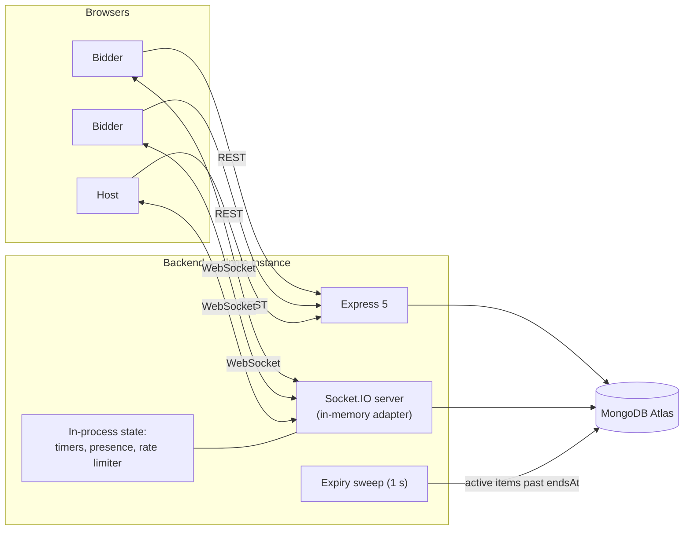

# Scaling

What this system can carry as built, what breaks first when it cannot, and what
the smallest correct fix is at each step. The ordering matters more than the
technology names: nothing here should be adopted before the limit above it has
actually been hit.

---

## 1. What runs in production today

One backend instance. One Node process. One MongoDB Atlas cluster. **No Redis.**

State that lives in the process rather than the database:

| State | Where | Lost on restart? | How it recovers |
|---|---|---|---|
| Auction countdowns | `Map<roomId, Timeout>` in `resolutionHandler.ts` | Yes | `restoreAuctionTimers()` on boot, plus the 1 s expiry sweep at any time |
| Presence | `PresenceStore` (in-memory default) | Yes | `isConnected` cleared on boot; clients re-register on `room:connect` |
| Rate-limit counters | `RateLimitCheck` (in-memory default) | Yes | Not rebuilt; a restart grants everyone a fresh window |

### Why Redis is not enabled in production

**Cost.** The project runs on free and near-free tiers by choice, and Redis buys
nothing on one instance: every broadcast already reaches every socket, and the
counters are already exact. Two instances would mean paying for Redis *and* a
second backend.

Estimated monthly cost on Railway, from its published usage prices (RAM $10 per
GB-month, CPU $20 per vCPU-month, read 2026-11-11). **These are estimates, not
measurements:**

| Addition | Assumed size | Estimated cost |
|---|---|---|
| Redis service | 50–100 MB RAM, near-idle CPU | about $1–2 / month |
| Second backend instance | same as the current one | roughly what the current instance costs again |

The code to run more than one instance is built and tested, but switched off. It
switches on with one environment variable (`REDIS_URL`), and nothing else needs
to change.

---

## 2. What a second instance needs, and what is already done

"Add Redis" answers three different problems, which fail differently. Each one
now has a fix in the code; the table says which run without Redis.

| Problem at two instances | Fix | Needs Redis? | Status |
|---|---|---|---|
| A bid accepted on instance A never reaches bidders on instance B | Socket.IO Redis Streams adapter | Yes | Built, opt-in, tested with two servers |
| An item whose timer lived on a dead instance never ends | Expiry sweep over MongoDB on every instance | **No** | Built, always on |
| Two instances resolve the same item | Conditional claim on `status: "active"` | No | Already safe; now also tested racing the sweep |
| Presence: a tab on each instance looks like two "first sockets" | `PresenceStore` backed by a Redis hash with expiring entries | Yes | Built, opt-in |
| Rate limits: N instances grant N× the budget | `RateLimitCheck` backed by a Redis fixed window | Yes | Built, opt-in |
| Clients miss or reorder events | Per-item `version` on every event, resync on gap | No | Built, always on |
| A retried bid is double-counted or told "too low" | Optional `bidId`, unique partial index | No | Built, always on |

### 2.1 What happens if Redis goes down (when enabled)

Measured locally by stopping Redis under a running server:

- **Bidding keeps working.** Bids are decided by MongoDB, not Redis.
- **Same-instance clients keep receiving every event.** The publish to Redis fails fast and local delivery proceeds.
- **Clients on other instances miss events until Redis returns.** Each item `version` makes the gap detectable, and the client resyncs through `room:connect`.
- **Rate limits and presence fall back to per-instance counts** for the duration.
- **The process does not crash, and the event loop keeps running.**
- When Redis returns, cross-instance delivery resumes without a restart.

If Redis is unreachable at boot, the server waits 5 seconds, logs it, and starts
in single-instance mode.

### 2.2 Still not solved for multiple instances

- **Startup presence reset.** Each instance clears every `isConnected` flag when it boots, including for people connected to other instances. They show offline until their next reconnect.
- **Sticky sessions.** The HTTP long-polling transport needs a load balancer with session affinity. A websocket-only client would not.
- **Timers are still duplicated.** Every instance restores a timer for every live room. This is harmless, because only one claim can win, but it is wasted work.

---

## 3. What breaks before any of that

Horizontal scaling is not the first limit this system will hit. In rough order:

| Limit | Symptom | Roughly when |
|---|---|---|
| Free-tier cold starts | 30–60 s to first byte after idle; clients sit in `reconnecting` | Immediately, on any low-traffic deployment |
| Single Atlas connection pool | Bid latency climbs; `bufferTimeoutMS` errors appear | Low hundreds of concurrent bidders |
| Reads per bid | Three reads before the claim: room, the `bidId` lookup (indexed; the frontend always sends one), then participant for the budget | Same range |
| Node event loop | Broadcast fan-out to every socket in a room, per accepted bid | Thousands of concurrent sockets |

**The point of this section:** a horizontal-scaling story is the wrong answer to
"it feels slow". The profile should say which row is actually binding before
anything is added.

---

## 4. What is deliberately not here

- **Kafka.** It is a durable log, not a WebSocket fan-out layer.
- **BullMQ or another job queue for timers.** Deadlines are already durable in MongoDB, and the expiry claim is idempotent. A queue would add a second place where a timer can be lost, and would make Redis a hard dependency for items ever ending.
- **A queue in front of bids.** Bidding is already serialized correctly by a single conditional `findOneAndUpdate`. A queue would add latency to the one path that most needs none.
- **A Redis Lua script as the bid authority.** It would create a second source of truth and a dual-write recovery problem, for latency this system does not need.
- **Transactions.** The bid claim is a single-document update.

---

## 5. Order of work, if the load ever arrives

1. Move off free-tier cold starts.
2. Profile. Find which row of section 3 is actually binding.
3. Trim the remaining reads on the bid path.
4. Only once one instance is genuinely saturated: add a Redis service, set `REDIS_URL`, run two instances behind a load balancer with sticky sessions. No code change is required.
5. Then fix the startup presence reset (section 2.2) before relying on the online indicators.

---

## 6. Measured on one instance (11 Nov 2026)

One Node process, local MongoDB, no Redis, production mode, one room, every
bidder bidding roughly once every 12 seconds for 30 seconds. Load generated
with k6 on the same 8-core, 8 GB laptop, so these are relative numbers, not a
capacity claim for the hosted deployment.

| Sockets in one room | Joined | Bids sent | Accepted | `bid:place` to `bid:accepted` p50 / p95 / p99 | Peak memory | All clients agreed on the final price |
|---|---|---|---|---|---|---|
| 1,000 | 1,000 | 2,488 | 61% | 10 / 32 / 54 ms | 231 MB | yes |
| 2,000 | 2,000 | 5,006 | 8% | 131 / 441 / 752 ms | 314 MB | yes |
| 5,000 | did not complete | none | n/a | n/a | 439 MB | n/a |

What this says:

- **The bid claim is not the limit.** Every bid was answered at every size that
  completed, and the stored data passed the invariant audit after each run.
- **Fan-out is.** At 2,000 sockets most bids are rejected as too low because
  the price a client sees is already stale by the time its bid arrives.
- **Joining is the first hard limit.** `room:state` carries the whole roster,
  so its size grows with the room (241 kB at 1,000 participants, 1.2 MB at
  5,000) and the total sent while a room fills grows with the square of it
  (about 6 GB for 5,000 joiners). Each join also broadcasts `participant:joined`
  to everyone already there (500,000 messages while 1,000 people join). A room
  of 5,000 does not finish joining.

The fix for the last point is a payload change, not infrastructure: send a
participant count and the first page of the roster in `room:state`, fetch the
rest on demand, and batch presence updates. That changes what the client
receives, so it is a decision, not a patch.
